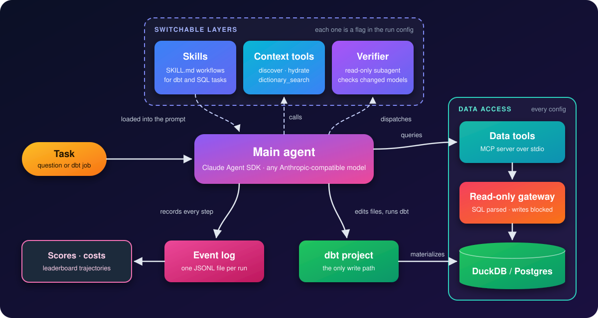

# data-agent

An open-source, self-hostable data agent. Give it a business question or a dbt task; it explores the
database, writes and runs SQL through a read-only gateway, edits the dbt project when the task calls
for it, and returns an answer with its assumptions stated.

It is a command-line agent built on the Claude Agent SDK, and it runs on any model behind an
Anthropic-compatible endpoint. Everything below was measured with `deepseek-flash`.

## Results

| Benchmark | Score | Runs | API cost | Submission |
|---|---|---|---|---|
| [data-eng-bench](https://github.com/Snowflake-Labs/data-eng-bench) (103 dbt tasks) | 64.1% ± 1.6 accuracy, pass@3 0.748 | 103 tasks × 3 | $15.16 | [PR #20](https://github.com/Snowflake-Labs/data-eng-bench/pull/20), open |
| [DataAgentBench](https://github.com/ucbepic/DataAgentBench) (54 queries, 12 datasets) | 0.7588 Pass@1, with the benchmark's official hints | 54 queries × 5 | $7.07 | [PR #144](https://github.com/ucbepic/DataAgentBench/pull/144), open |

Both scores are local runs graded by each benchmark's own scripts. Both submissions are waiting for
the maintainers, so neither number is on a leaderboard yet. A run of one task is called a trial
below.

- **data-eng-bench**: run with the `no-verifiers` config (see below). By difficulty, easy 100% (3 tasks), medium 70.9%, hard 57.8%, very hard 45.8%.
  The 309 trials and their trajectories are public on Harbor Hub.
- **DataAgentBench**: run with Skills on, using the benchmark's own tool server (its database
  tools and a Python sandbox) instead of the tools described below. The first run of all 54 queries
  scored 0.7421. After reading its failures I made three
  general fixes (answer format, a visible turn budget, a text-classification tool) and reran
  everything, which gave 0.7588. The submission states this. The cost is for the submitted config;
  the rerun with its baseline cost $13.57. The 270 trajectories are in the
  [release](https://github.com/kevinWangSheng/data-agent/releases/tag/dab-submission-2026-11-15).

## Quickstart

You need Python 3.12, [uv](https://docs.astral.sh/uv/), and an API key for a model served over the
Anthropic API format. The default endpoint is DeepSeek's.

```bash
git clone https://github.com/kevinWangSheng/data-agent && cd data-agent
uv sync
export DATA_AGENT_API_KEY=...        # optional: DATA_AGENT_BASE_URL, DATA_AGENT_MODEL

# Build the small sample database (a shop with deliberately dirty keys and enum values).
uv run python -c "import duckdb; duckdb.connect('shop.duckdb').execute(open('tests/fixtures/shop.sql').read())"

mkdir -p work events
uv run data-agent run --type query --config no-verifiers \
  --duckdb shop.duckdb --workspace work --events-dir events \
  --task "Which customer tier has the highest total amount of completed orders, and how much is it?"
```

Output of that run on 2026-11-15 (22 seconds, 13 turns, $0.007):

```text
**Gold — 710.00**

Assumptions:
- Tier values "Gold", "GOLD" and "gold_tier" are the same tier; "Silver"/"silver" likewise.
- Order statuses "completed", "Completed" and "COMPLETE" all count as completed orders.
- Amounts are summed per order from the order-level table, so no item-level duplication inflates the total.
```

For your own data, replace `--duckdb FILE` with `--postgres-env VAR`, where `VAR` is the name of an
environment variable holding a Postgres URL. For dbt work, use `--type dbt` and point `--workspace`
at the dbt project. `events/` gets one JSONL file per run with every tool call, SQL statement, token
count and cost.

## How it works



One main agent runs one task. Three layers sit on top of it, and each is a switch in a run config, so
each can be turned off and measured:

- **Skills.** Six `SKILL.md` files in [`skills/`](skills/) describe how to do a kind of task: how far
  to explore, when to start writing, what to check before delivering. A dbt task loads an eight-step
  dbt workflow with its writing and debugging guides; a query task loads a SQL workflow. Both get a
  guide for the database's dialect. They are adapted from SignalPilot's plugin and then revised from
  failures on a development set (30 benchmark tasks set aside for that purpose).
- **Context tools.** `discover` returns references and short summaries, `hydrate` expands one
  reference, and `dictionary_search` looks up real column values from an index built at the start of
  the run. The agent never gets the whole schema pushed into its context.
- **Verifier.** In dbt runs, a read-only subagent checks changed models against the task. Facts that
  can be computed come from tools, not from its judgment: what changed since the run started,
  whether the columns match the contract, null and duplicate keys, and a comparison by key against
  a reference query the verifier writes. Harness hooks decide when it is dispatched and whether the
  main agent may stop.

Under the layers, in every config (DataAgentBench runs swap the data tools for the benchmark's
own):

- **Read-only gateway.** Every SQL statement is parsed first; DDL, DML and dangerous functions are
  rejected. The only way the agent changes data is by editing the dbt project and running `dbt`.
- **Base tools.** `list_tables`, `describe_table`, `query_database` and `explain_query`; for
  questions that need rows labelled by meaning, `classify_text` labels them with a model call and
  `query_labels` queries the result. Outputs are capped and say what was left out.
- **Guards and budgets.** Query runs have no shell. In dbt runs, Bash may only run `dbt` and the
  workflow's scripts. File tools are confined to the workspace. Each run has a turn limit, a dollar
  budget and an optional deadline; in query runs the agent sees its turn limit and is reminded as it
  runs low. The budget is counted from a price table that currently lists two DeepSeek models.
- **Event log.** One append-only JSONL file per run is the single record. Scores, costs, failure
  attribution and the leaderboard trajectories are all derived from it.

## What the ablation shows

On 30 held-out data-eng-bench tasks (kept apart from the development set), 3 trials each, with one
layer turned off at a time:

| Config | Accuracy |
|---|---|
| full (all layers on) | 66.7% ± 1.6 |
| no-verifiers | 71.1% ± 1.9 |
| no-skill | 64.4% ± 2.5 |
| no-context | 57.8% ± 2.2 |
| baseline (all layers off) | 65.6% ± 2.7 |

None of the paired differences is significant at this sample size (task-level bootstrap, 95%
interval). The largest is full over no-context at +8.9 points. So the data cannot say which layer
helps, and I don't claim one does.

What the data does support:

- The verifier layer roughly doubles the cost per successful task (on the development set, $0.147
  against $0.072 without it) and did not raise accuracy in any measurement. The recommended config
  is therefore `no-verifiers`, and the data-eng-bench submission was run with it.
- On DataAgentBench, Skills on scored above the baseline both times all 54 queries were run: +4.09
  points the first time (interval +1.18 to +6.88) and +3.70 the second (interval −1.51 to +9.07,
  which crosses zero). The verifier and context tools play no part there.

The held-out tasks were sampled in advance, and their per-task failures were never used during
development. Skills were only changed from failures on the development set.

## Reproducing the evaluations

The evaluation code is in [`evals/`](evals/): sampling, batch runs through
[Harbor](https://github.com/laude-institute/harbor) (the benchmark's container harness), scoring with each benchmark's own metrics, paired
bootstrap comparison, spend tracking, and scrubbing keys and addresses out of trajectories before
upload.

```bash
uv run python -m evals --help
uv run python -m evals board --help    # one config on the registry's data-eng-bench, for the leaderboard
uv run python -m evals ablate --help   # several configs on a split
uv run python -m evals dab --help      # DataAgentBench queries
```

The runs above used one 6-core, 8 GB Linux server with Docker, three trials at a time. All formal
evaluation runs together cost about $81 in API fees. The full results, costs and failure attribution
are in the [evaluation report](docs/report.md); the run-by-run record, including what went wrong, is
in [`docs/adr/0008-change-acceptance.md`](docs/adr/0008-change-acceptance.md).

## Limitations

- Measured with one model. The numbers, and which layers are worth their cost, may differ on another.
- The ablation is too small to separate the layers (see above).
- The context tools were rarely called on dbt tasks, so their measured effect there says little.
- The DataAgentBench fixes were made after seeing failures on that benchmark. They contain nothing
  specific to a query or dataset, but the 0.7588 is not a blind score; 0.7421 is.
- Two DataAgentBench questions require the agent's text classification to match the dataset's own
  labels exactly; they failed in every run.
- Data sources are DuckDB, Postgres and dbt projects. There is no web interface, no clarifying
  question to the user, and no memory across runs yet.

## How it was built

The code was written by coding agents under a fixed process: one ticket, one agent, one git worktree;
tests first; a real run with its output recorded; then reviews by two different models, and a third
on the pull request, before the merge. A human decided the specs, the acceptance tests and every large evaluation run. The
repository keeps the whole trail:

- [`docs/plan.md`](docs/plan.md): the plan and the development process (section 6).
- [`docs/adr/`](docs/adr/): decisions, including the ones that were reversed.
- [`.scratch/`](.scratch/): every spec and ticket, with review findings and run output.
- 77 merged pull requests and about 2,200 tests (`make check`).

These documents are in Chinese.

## License

Apache-2.0. Parts come from three Apache-2.0 projects:

- [SignalPilot](https://github.com/SignalPilot-Labs/SignalPilot) and its plugin: the SQL gateway
  engine (copied), the Skills and the verifier prompt (adapted), and the older verifier tools.
- [ktx](https://github.com/Kaelio/ktx): the data-dictionary sampling settings and the idea behind
  the context tools.
- [data-eng-bench](https://github.com/Snowflake-Labs/data-eng-bench): the scoring functions and the
  Harbor job config.

[`NOTICE`](NOTICE) lists every copied file and what was changed.
