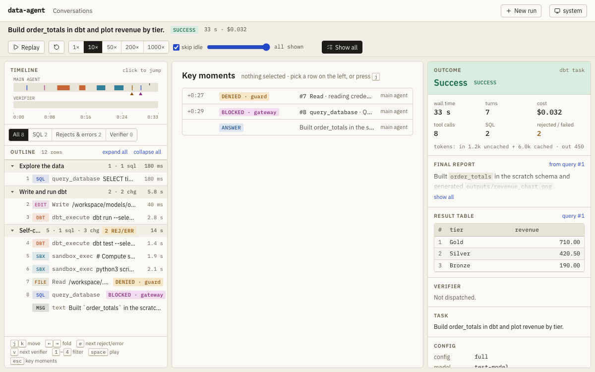

# data-agent

An open-source, self-hostable data agent. Give it a business question or a dbt task; it explores the
database, writes and runs SQL through a read-only gateway, edits the dbt project when the task calls
for it, and returns an answer with its assumptions stated.

It is a command-line agent built on the Claude Agent SDK, and it runs on any model behind an
Anthropic-compatible endpoint. Everything below was measured with `deepseek-flash`.

**Online version: <https://kevinwangsheng.github.io/data-agent/>**. It replays real runs step by
step and shows the evaluation results. It is read-only and cannot start a run.



## Results

| Benchmark | Score | Runs | API cost | Submission |
|---|---|---|---|---|
| [data-eng-bench](https://github.com/Snowflake-Labs/data-eng-bench) (103 dbt tasks) | 64.1% ± 1.6 accuracy, pass@3 0.748 | 103 tasks × 3 | $15.16 | [PR #20](https://github.com/Snowflake-Labs/data-eng-bench/pull/20), open |
| [DataAgentBench](https://github.com/ucbepic/DataAgentBench) (54 queries, 12 datasets) | 0.7421 Pass@1 (blind run), with the benchmark's official hints | 54 queries × 5 | $5.16 | [PR #144](https://github.com/ucbepic/DataAgentBench/pull/144), open |

Both scores are local runs graded by each benchmark's own scripts. Both submissions are waiting for
the maintainers, so neither number is on a leaderboard yet. A run of one task is called a trial
below.

- **data-eng-bench**: run with the `no-verifiers` config (see below). By difficulty, easy 100% (3 tasks), medium 70.9%, hard 57.8%, very hard 45.8%.
  The 309 trials and their trajectories are public on Harbor Hub.
- **DataAgentBench**: run with Skills on, using the benchmark's own tool server (its database
  tools and a Python sandbox) instead of the tools described below. The submitted score is the
  blind run, made before any DataAgentBench result had been seen. Two later rounds of general
  changes, made after looking at this benchmark's failures and at other submissions' notes, scored
  0.7588 and 0.7639. By the leaderboard's definition those rounds count as a tuned prompt, so they
  are reported here and in the [evaluation report](docs/report.md) but not submitted. The cost is
  for the submitted config. The 270 trajectories are in the
  [release](https://github.com/kevinWangSheng/data-agent/releases/tag/dab-submission-2026-11-13).
- **Your own Postgres and dbt project**: on dbt Labs' `jaffle_shop` with a local Postgres, 7 cases
  (3 questions, 2 dbt changes, 2 direct-write requests that must be refused) passed 7/7 on commit
  `71a5bcc` for $0.14 (`python -m evals jaffle`; details in the
  [evaluation report](docs/report.md#postgres-and-dbt-outside-the-benchmarks)).

## Quickstart

You need Python 3.12, [uv](https://docs.astral.sh/uv/), Docker, and an API key for a model served
over the Anthropic API format. The default endpoint is DeepSeek's. The agent runs its shell commands
and code in a Docker container of each run's own (`--sandbox docker`, the default), built once with
`make sandbox-image`; without Docker a run stops with exit code 2.

```bash
git clone https://github.com/kevinWangSheng/data-agent && cd data-agent
uv sync
export DATA_AGENT_API_KEY=...        # optional: DATA_AGENT_BASE_URL, DATA_AGENT_MODEL
make sandbox-image                   # the container image sandbox_exec runs in

# Build the small sample database (a shop with deliberately dirty keys and enum values).
uv run python -c "import duckdb; duckdb.connect('shop.duckdb').execute(open('tests/fixtures/shop.sql').read())"

mkdir -p work events
uv run data-agent run --type query --config no-verifiers \
  --duckdb shop.duckdb --workspace work --events-dir events \
  --task "Which customer tier has the highest total amount of completed orders, and how much is it?"
```

Output of that run on 2026-11-15 (22 seconds, 13 turns, $0.007):

```text
**Gold — 710.00**

Assumptions:
- Tier values "Gold", "GOLD" and "gold_tier" are the same tier; "Silver"/"silver" likewise.
- Order statuses "completed", "Completed" and "COMPLETE" all count as completed orders.
- Amounts are summed per order from the order-level table, so no item-level duplication inflates the total.
```

For your own data, replace `--duckdb FILE` with `--postgres-env VAR`, where `VAR` is the name of an
environment variable holding a Postgres URL. For dbt work, use `--type dbt` and point `--workspace`
at the dbt project. The container mounts the workspace, so a DuckDB file must sit outside it (a run
refuses one inside); `--dbt-target scratch` has dbt write to a schema of the run's own. `events/` gets one JSONL file per run with every tool call, SQL statement, token
count and cost. `data-agent run` stays offline unless given `--network`, which gives the agent
WebSearch, WebFetch and a container that can reach the network.

### Web UI

`data-agent web` serves a page on this machine's loopback address only. You submit a task there and
watch the run step by step as it happens. You can also cancel it, or open any earlier run from the
run list. The local UI also includes a chat view that supports multi-turn follow-ups, clarifying
questions when the agent needs input, and mid-run steering. A wheel built where [pnpm](https://pnpm.io/) is on `PATH` carries the built page, so
installing from it needs no Node. From a checkout, build the page once:

```bash
pnpm --dir web install && pnpm --dir web build:local

cat > sources.toml <<'EOF'
[sources.shop]
kind = "duckdb"
path = "shop.duckdb"
EOF

mkdir -p runs-web
uv run data-agent web --runs-dir runs-web --data-sources sources.toml   # http://127.0.0.1:8765
```

The form offers the data sources by name only. A Postgres source names the environment variable
holding its URL (`kind = "postgres"`, `env = "VAR"`), so the URL stays in the server's environment.
A source used for dbt tasks adds `dbt_project = "DIR"`. Each dbt run works on its own copy of that
project. Without `--data-sources` the page still lists and replays runs, but cannot start one. Runs
started with `data-agent run --events-dir runs-web/<name>` appear in the list too. One run goes at a
time.

Runs started from the page are online by default, with a toggle in the UI to turn network access
off: when online, the agent gets WebSearch and WebFetch, and its container can reach the network
(to `pip install` a package, say). Data it has queried can then
leave the machine through its code or a web request. Runs from the page always use the Docker
sandbox, and a dbt run writes only to a schema of its own (`da_run_<run id>`), never the project's
production schemas.

### Slack

`data-agent web --im FILE` also starts a Slack bot in the same process. The bot uses Socket Mode,
so it needs no public address. People on an allowed list message it directly, or mention it in a
channel. It answers in the message's thread, and a reply in that thread continues the same
conversation. These conversations are the web UI's own: they show in its conversation list and can
be replayed there. The Slack libraries are an optional extra:

```bash
uv sync --extra im          # an installed wheel: the extra data-agent[im]

cat > ~/.config/data-agent/im.toml <<'EOF'
[slack]
bot_token_env = "DATA_AGENT_SLACK_BOT_TOKEN"   # the bot token (xoxb-...)
app_token_env = "DATA_AGENT_SLACK_APP_TOKEN"   # the app-level token for Socket Mode (xapp-...)
allowed_users = ["U012ABCDEF"]                 # Slack member ids
EOF

uv run data-agent web --runs-dir runs-web --data-sources sources.toml --im ~/.config/data-agent/im.toml
```

- **The file holds variable names only.** Each name must start with `DATA_AGENT_SLACK_`, and the
  token values stay in the environment. A missing variable, an empty `allowed_users` list or a
  name with another prefix stops the server from starting, and the error names the platform.
  Runs are started without these variables, so no run and no event file ever holds a Slack token.
- **The allowed list.** Only listed users can start a turn, steer one, stop one or press a button.
  Anyone else who messages the bot directly is told their member id, so they can ask to be added.
  In a channel the bot ignores them. The bot answers in every channel it has been invited to,
  and who can read those answers is set by the channel's own membership.
- **A turn.** A turn posts one status message, which is edited about every two seconds as the
  steps go by and has a Stop button. Typing `stop` in the thread stops the turn too. A
  clarifying question lists its options as numbered lines, with one button per number; you can
  also type an answer. The answer arrives as messages of its own, split at paragraphs. Tables
  become code blocks of at most 20 rows, with the total row count given.
- **Errors.** When a run fails, the bot names the cause (the model call, the budget or the turn
  limit) and gives the run id. If the bot cannot connect to Slack, it only writes a log line; the
  web UI keeps working.

Known limits:

- A message sent just as a turn ends counts as a steer but never reaches the turn. The web UI
  has the same limit.
- Answers in a channel can be read by every member of that channel.
- Each question costs model spend, and there is no spending cap per conversation.
- Charts are not drawn in Slack. The bot says how many charts an answer has, and you see them in
  the web UI.
- Socket Mode apps cannot be listed in the public Slack Marketplace.

Setting up the Slack app (scopes, events, tokens) is described in
[docs/setup.md](docs/setup.md#slack-机器人工单-131).

### Telegram

With a `[telegram]` table in the `--im` file, `data-agent web` also starts a Telegram bot in the
same process. It uses long polling, so it needs no public address either, and it shares the web
UI's conversations, like the Slack bot. Telegram chats have no threads, so each chat has one
current conversation: every message in it continues that conversation until someone sends
`/new`. The same extra installs the Telegram library (aiogram):

```bash
uv sync --extra im

cat > ~/.config/data-agent/im.toml <<'EOF'
[telegram]
bot_token_env = "DATA_AGENT_TELEGRAM_BOT_TOKEN"   # the token @BotFather gave
allowed_users = [123456789]                       # Telegram user ids (numbers)
EOF

uv run data-agent web --runs-dir runs-web --data-sources sources.toml --im ~/.config/data-agent/im.toml
```

A file can hold both a `[slack]` and a `[telegram]` table; both bots then run.

- **The file holds variable names only.** The name must start with `DATA_AGENT_TELEGRAM_`; the
  token stays in the environment, and runs are started without it.
- **The allowed list** holds numeric user ids. Anyone else who messages the bot privately is told
  their id; in a group the bot ignores them.
- **`/new`** starts a new conversation in the chat. Text after it, as in `/new revenue by month?`,
  is the first question of the new conversation. The bot lists `/new` in Telegram's command menu.
  In a group, send `/new@its_username`: a bare `/new` there does not mention the bot, so the bot
  ignores it.
- **In a group** the bot answers a message that mentions it (`@its_username`) or replies to one of
  its messages, and nothing else: with no threads, a follow-up needs the mention or the reply
  every time. In a private chat it answers every message.
- **A turn** works as on Slack: a status message edited about once a second with a Stop button,
  `stop` typed in the chat, numbered buttons for a clarifying question, the answer split at
  paragraphs into messages of up to 4,000 characters.

Known limits:

- Forum topics are not supported. A message in a topic is handled as an ordinary message of the
  group, and the bot's reply goes to the group, outside the topic.
- With Group Privacy turned off (which the setup asks for), the bot receives every message of its
  groups. It answers only those that mention it or reply to it.
- Each question costs model spend, and there is no spending cap per conversation.
- Charts are not drawn in Telegram; the bot says how many charts an answer has.

Creating the bot and turning off Group Privacy is described in
[docs/setup.md](docs/setup.md#telegram-机器人工单-132).

### Discord

The same `--im` file can also start a Discord bot, alone or next to the other bots: add a
`[discord]` table. The bot connects to Discord's gateway, so it needs no public address either. It uses the same
extra (`uv sync --extra im`), and its conversations are the web UI's own, like Slack's.

```toml
[discord]
bot_token_env = "DATA_AGENT_DISCORD_BOT_TOKEN"   # the bot token from the Developer Portal
allowed_users = ["123456789012345678"]           # Discord user ids, written as strings
```

- **In a server channel**, mention the bot (`@data-agent how many orders last month?`). It makes a
  thread from your message and answers there. Messages in that thread go to the same
  conversation, with no mention needed. Replying to one of the bot's messages with the ping on
  counts as a mention; `@everyone`, `@here` and role mentions do not.
- **In a direct message**, every message goes to the chat's current conversation. The `/new`
  slash command ends it, so the next message starts a new one. `/new` in one of the bot's threads
  ends that thread's conversation too; the bot then forgets the thread, so mention it to start
  the next conversation there.
- **The allowed list, a turn, errors.** These work as on Slack (above). The status message has a
  Stop button and is edited about every two seconds. A clarifying question has one button per
  option. Anyone not on the list who sends a direct message is told their user id. In a channel,
  the bot ignores them and makes no thread. Nothing the bot writes notifies anyone: `@everyone` in
  an answer stays plain text.
- The file holds the variable's name only, starting with `DATA_AGENT_DISCORD_`. Runs are started
  without it, so no run and no event file ever holds the Discord token.

Known limits:

- A thread the bot makes is visible to everyone who can read its channel.
- Each question costs model spend, and there is no spending cap per conversation.
- Replying in a thread Discord has archived (after a day without messages) is not yet confirmed.
  Discord's docs say a message unarchives the thread unless a moderator locked it. They also say
  `/new` cannot be used there. The live test will settle it.
- If the bot cannot make a thread (no permission, or a channel without threads), it answers in
  the channel as replies to your message. Each new mention there then starts a new conversation.
- Charts are not drawn in Discord, as on Slack.

Setting up the Discord app (intent, scopes, permissions, token) is described in
[docs/setup.md](docs/setup.md#discord-机器人工单-133).

### Traces in Langfuse (optional)

Each run can also be exported as a trace to [Langfuse](https://langfuse.com/). The trace shows every
model request (tokens, cost, time to first token), the tool calls and the verifier subagent as one
tree. Set all three variables; with any of them missing nothing is exported, no port is opened and
no request is made:

```bash
export DATA_AGENT_LANGFUSE_PUBLIC_KEY=pk-lf-...
export DATA_AGENT_LANGFUSE_SECRET_KEY=sk-lf-...
export DATA_AGENT_LANGFUSE_BASE_URL=https://us.cloud.langfuse.com
uv run data-agent run ...                          # the event file gets a `trace` event with the link
uv run data-agent trace-check runs/x/run-....jsonl # the trace's structure as Langfuse received it
```

Langfuse Cloud and a self-hosted Langfuse differ only in `DATA_AGENT_LANGFUSE_BASE_URL`; to host
your own, see Langfuse's [Docker Compose guide](https://langfuse.com/self-hosting/deployment/docker-compose).
The Claude Code CLI's spans go first to a relay inside the run's process on `127.0.0.1`, which adds
the keys and forwards them: the CLI never sees the keys.

There are two tiers (`data-agent run --trace-tier`):

- `full` (the default, also for the web UI): everything is recorded (prompts, SQL, tool output,
  query results, the answer), except credentials, the model endpoint and what names the machine
  (`user.id`, `host.*`, `os.*`). The CLI exports no tool input and no model text, so the run adds
  them from its own events: each tool span gets its call's input (the SQL of `query_database`), and
  each of the model's messages is an `assistant.message` under the run's span (a verifier's names
  it in `parent`). Send to Langfuse Cloud only runs on public demo data (jaffle-shop, this repo's
  fixtures, public benchmarks).
- `structure`: only an allowlist of structure fields (span names, timings, token counts, tool and
  model names), with anonymous ids.

The run's span carries the cost; its token total is metadata (`usage_total`), so Langfuse counts each
model request's tokens once.

Evaluation commands (`evals ablate`, `evals board`, `evals dab`, `evals jaffle`) export only with
`--trace`, and only the first trial of each task. data-eng-bench picks the tier by the task's split
in `evals/manifest.json`: dev tasks `full`, everything else `structure`. DataAgentBench, which has
no held-out split, uses `full`; jaffle-shop, which is not in the manifest, uses `structure`.

### External MCP servers

`data-agent run --mcp-servers FILE` and `data-agent web --mcp-servers FILE` give the agent the tools
of MCP servers you already use, such as MongoDB's or GitHub's. `FILE` is a Claude Code / Cursor
`mcpServers` JSON kept outside the repository, with one addition: each server lists the tools the
agent may call in `allowedTools`.

```json
{
  "mcpServers": {
    "github": {
      "type": "http",
      "url": "https://api.githubcopilot.com/mcp/readonly",
      "headers": {"Authorization": "Bearer ${DATA_AGENT_MCP_GITHUB_TOKEN}"},
      "allowedTools": ["*"]
    }
  }
}
```

- Transports: `stdio` (the default when `type` is left out) and `http`. A server that uses `sse`,
  OAuth, an unknown type or an unknown field is refused. A run with a bad file stops before its
  session starts, with exit code 2 and an error that names the server.
- `allowedTools`: `["find", "aggregate"]` allows those two tools, and `["*"]` allows all of the
  server's tools. A server without the list, or with an empty one, is not mounted, and the run prints
  a warning. Tools not on the list are refused. Tool annotations such as "read-only" count for
  nothing.
- Credentials: write `${DATA_AGENT_MCP_<NAME>}` in `env` or `headers` values, and set the variable
  in the environment. `data-agent` expands only variables with that prefix, and only in those two
  places. An unset variable, another prefix, or `${...}` anywhere else stops the run. The server
  name `data` is reserved. A name may use only letters, digits, `-` and `_`, may not contain `__`,
  and may not start or end with `_`. The event file masks every referenced variable's value
  everywhere it appears, so reference only secrets this way. Write plain settings such as `"true"`
  as literals.
- Each stdio server is started through `data-agent mcp-launch`. It starts from a clean environment
  (`PATH`, `HOME`, `LANG` and a few other basic variables) plus the server's own `env`. The server
  never sees the model key, database URLs or Langfuse keys. If your Docker needs `DOCKER_HOST`, add
  it to the server's `env`.
- The run's `version` event records each mounted server's name and allow list, and nothing else
  from the file. The evaluation entry points never mount external servers.

Complete MongoDB and GitHub setups are in [`docs/setup.md`](docs/setup.md#外部-mcp-server工单-116).

Risks you take on with `--mcp-servers`:

- A write tool on the allow list (MongoDB's `insert-many`, say) runs without asking. Leave write
  tools off the list, or use the server's own read-only mode.
- stdio servers run on this machine, outside the sandbox. `--network` does not limit their network
  access.
- External tools' inputs and outputs are written to the event file. They also go to your Langfuse
  when trace export is on.

## How it works


One main agent runs one task. Three layers sit on top of it, and each is a switch in a run config, so
each can be turned off and measured:

- **Skills.** Six `SKILL.md` files in [`skills/`](skills/) describe how to do a kind of task: how far
  to explore, when to start writing, what to check before delivering. A dbt task loads an eight-step
  dbt workflow with its writing and debugging guides; a query task loads a SQL workflow. Both get a
  guide for the database's dialect. They are adapted from SignalPilot's plugin and then revised from
  failures on a development set (30 benchmark tasks set aside for that purpose).
- **Context tools.** `discover` returns references and short summaries, `hydrate` expands one
  reference, and `dictionary_search` looks up real column values from an index built at the start of
  the run. The agent never gets the whole schema pushed into its context.
- **Verifier.** In dbt runs, a read-only subagent checks changed models against the task. Facts that
  can be computed come from tools, not from its judgment: what changed since the run started,
  whether the columns match the contract, null and duplicate keys, and a comparison by key against
  a reference query the verifier writes. Harness hooks decide when it is dispatched and whether the
  main agent may stop.

Under the layers, in every config (DataAgentBench runs swap the data tools for the benchmark's
own):

- **Read-only gateway.** Every SQL statement of the data tools is parsed first; DDL, DML and
  dangerous functions are rejected, and the connection itself is read-only.
- **Sandbox and dbt_execute.** Shell commands and code run through `sandbox_exec` in an isolated
  environment with no database credentials and no database file: a Docker container per run, or the
  benchmark's own task container. Query results reach it as CSV files. The only way the agent
  changes data is by editing the dbt project and running it with `dbt_execute`, the one tool that
  holds the connection profile (ADR-0010).
- **Base tools.** `list_tables`, `describe_table`, `query_database` and `explain_query`; for
  questions that need rows labelled by meaning, `classify_text` labels them with a model call and
  `query_labels` queries the result. Outputs are capped and say what was left out.
- **Guards and budgets.** There is no Bash on the agent's machine. File tools are confined to the
  workspace and kept off credential files. Benchmark and evaluation runs never get the network.
  Each run has a turn limit, a dollar
  budget and an optional deadline; in query runs the agent sees its turn limit and is reminded as it
  runs low. The budget is counted from a price table that currently lists two DeepSeek models.
- **Event log.** One append-only JSONL file per run is the single record. Scores, costs, failure
  attribution and the leaderboard trajectories are all derived from it.

## What the ablation shows

On 30 held-out data-eng-bench tasks (kept apart from the development set), 3 trials each, with one
layer turned off at a time:

| Config | Accuracy |
|---|---|
| full (all layers on) | 66.7% ± 1.6 |
| no-verifiers | 71.1% ± 1.9 |
| no-skill | 64.4% ± 2.5 |
| no-context | 57.8% ± 2.2 |
| baseline (all layers off) | 65.6% ± 2.7 |

None of the paired differences is significant at this sample size (task-level bootstrap, 95%
interval). The largest is full over no-context at +8.9 points. So the data cannot say which layer
helps, and I don't claim one does.

What the data does support:

- The verifier layer roughly doubles the cost per successful task (on the development set, $0.147
  against $0.072 without it) and did not raise accuracy in any measurement. The recommended config
  is therefore `no-verifiers`, and the data-eng-bench submission was run with it.
- On DataAgentBench, Skills on scored above the baseline in all three full runs, but the gap
  shrank: +4.09 points the first time (interval +1.18 to +6.88), +3.70 the second (−1.51 to
  +9.07) and +0.25 the third (−6.93 to +7.62); only the first is significant. The verifier and
  context tools play no part there.

The held-out tasks were sampled in advance, and their per-task failures were never used during
development. Skills were only changed from failures on the development set.

## Reproducing the evaluations

The evaluation code is in [`evals/`](evals/): sampling, batch runs through
[Harbor](https://github.com/laude-institute/harbor) (the benchmark's container harness), scoring with each benchmark's own metrics, paired
bootstrap comparison, spend tracking, and scrubbing keys and addresses out of trajectories before
upload.

```bash
uv run python -m evals --help
uv run python -m evals board --help    # one config on the registry's data-eng-bench, for the leaderboard
uv run python -m evals ablate --help   # several configs on a split
uv run python -m evals dab --help      # DataAgentBench queries
```

The runs above used one 6-core, 8 GB Linux server with Docker, three data-eng-bench trials at a time (DataAgentBench ran four datasets in parallel). All formal
evaluation runs together cost about $106 in API fees. The full results, costs and failure attribution
are in the [evaluation report](docs/report.md); the run-by-run record, including what went wrong, is
in [`docs/adr/0008-change-acceptance.md`](docs/adr/0008-change-acceptance.md).

## Limitations

- Measured with one model. The numbers, and which layers are worth their cost, may differ on another.
- The ablation is too small to separate the layers (see above).
- The context tools were rarely called on dbt tasks, so their measured effect there says little.
- The two DataAgentBench rounds after the blind run were made after seeing that benchmark's
  failures. They contain nothing specific to a query or dataset, but 0.7588 and 0.7639 are not
  blind scores; 0.7421 is, and it is the one submitted.
- Two DataAgentBench questions require the agent's text classification to match the dataset's own
  labels exactly; they failed in every run.
- Data sources are DuckDB, Postgres and dbt projects. There is no memory across runs yet. The web UI
  is for one user on one machine: it has no login.
- External MCP servers (`--mcp-servers`) have no confirmation before a write tool runs. Their stdio
  processes run on the host, with network access that `--network` does not control. An http
  server's expanded headers reach the Claude Code CLI as part of its `--mcp-config` argument, so
  other local users who can list this machine's processes can see them. stdio servers' values do not reach any
  argv: they reach the wrapper through the CLI's environment. The wrapper reads the file again when
  the CLI starts the server, so an edit made to the file during a run takes effect at that point.

## How it was built

The code was written by coding agents under a fixed process: one ticket, one agent, one git worktree;
tests first; a real run with its output recorded; then reviews by two different models, and a third
on the pull request, before the merge. A human decided the specs, the acceptance tests and every large evaluation run. The
repository keeps the whole trail:

- [`docs/plan.md`](docs/plan.md): the plan and the development process (section 6).
- [`docs/adr/`](docs/adr/): decisions, including the ones that were reversed.
- [`.scratch/`](.scratch/): every spec and ticket, with review findings and run output.
- 77 merged pull requests and about 2,200 tests (`make check`).

These documents are in Chinese.

## License

Apache-2.0. Parts come from three Apache-2.0 projects:

- [SignalPilot](https://github.com/SignalPilot-Labs/SignalPilot) and its plugin: the SQL gateway
  engine (copied), the Skills and the verifier prompt (adapted), and the older verifier tools.
- [ktx](https://github.com/Kaelio/ktx): the data-dictionary sampling settings and the idea behind
  the context tools.
- [data-eng-bench](https://github.com/Snowflake-Labs/data-eng-bench): the scoring functions and the
  Harbor job config.

[`NOTICE`](NOTICE) lists every copied file and what was changed.
